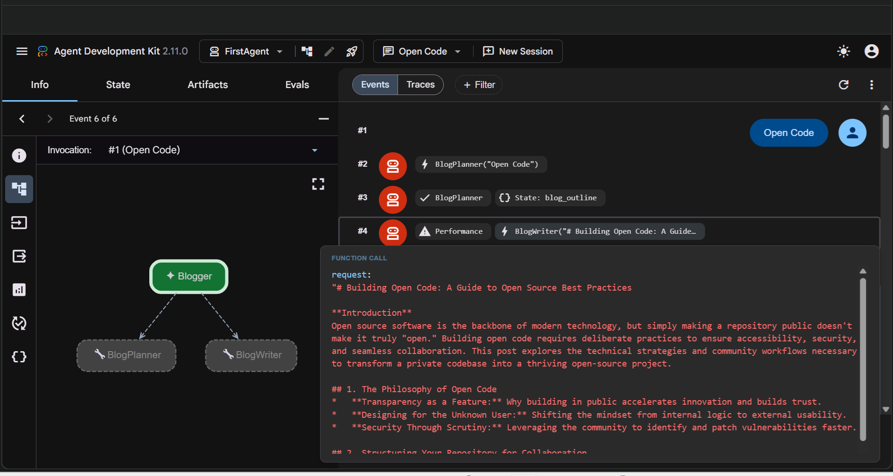

# Multi-Agent Blogger

A Google ADK (Agent Development Kit) project that creates technical blog posts using a two-agent pipeline: **Planner** → **Writer**.

## Architecture

```
Blogger (root_agent)
├── BlogPlanner (via planner_tool)
└── BlogWriter (via writer_tool)
```

### Agents

| Agent | Role | Output |
|-------|------|--------|
| **BlogPlanner** | Creates structured Markdown outlines | `blog_outline` (state) |
| **BlogWriter** | Writes full blog post from outline | `blog_post` (state) |
| **Blogger** | Orchestrates: calls planner, then writer, adds titles/hooks | Final response |

## How It Works

1. **User provides a topic** (e.g., "The Future of AI in Healthcare")
2. **BlogPlanner** generates a Markdown outline with:
   - Title
   - Introduction (2-3 sentences)
   - 4-6 main sections with 2-3 bullets each
   - Conclusion
3. **BlogWriter** writes the complete article following the outline:
   - Technical audience (software engineers)
   - Explains both "how" and "why"
   - Includes code snippets where helpful
   - H2/H3 structure matching outline
4. **Blogger** returns the article + 3 alternate titles + 2 tweet-length hooks

## Prerequisites

- **Python 3.10+**
- **Google Gemini API Key** → Get one at [ai.google.dev](https://ai.google.dev/gemini-api/docs/api-key)
- **Virtual environment** (recommended)

### What is `.venv`?
A **Python virtual environment** - an isolated folder containing its own Python interpreter and packages. This prevents dependency conflicts with other projects. Created with:
```bash
python -m venv .venv
```

### What is `.adk`?
**ADK local storage** - automatically created by the Agent Development Kit when you run `adk web`. Stores:
- Session data (`session.db`)
- Credentials (experimental)
- Artifacts

**Both `.venv` and `.adk` are in `.gitignore` and should NOT be committed.**

## Quick Start

```bash
# 1. Clone / navigate to project
cd FirstAgent

# 2. Create virtual environment (one-time)
python -m venv .venv

# 3. Activate it
# Windows PowerShell:
.\.venv\Scripts\Activate.ps1
# Windows CMD:
.\.venv\Scripts\activate.bat
# Linux/Mac:
source .venv/bin/activate

# 4. Install dependencies
pip install google-adk python-dotenv

# 5. Configure API key
echo "GEMINI_API_KEY=your_actual_key_here" > .env
echo "MODEL=gemini-2.5-flash" >> .env

# 6. Run the web UI
python -m google.adk.cli web
```

Then open **http://127.0.0.1:8000** in your browser.

## Example Usage

In the web UI, type:
> Write a blog post about "Building RAG Systems with LangChain"

The agent will:
1. Plan the outline
2. Write the full article
3. Return the post + alternate titles + social hooks

## Project Structure

```
FirstAgent/
├── agent.py           # Agent definitions (Blogger, BlogPlanner, BlogWriter)
├── .env               # API keys (NOT committed)
├── .gitignore         # Excludes .venv, .adk, __pycache__, .env
├── .venv/             # Virtual environment (auto-generated)
├── .adk/              # ADK local storage (auto-generated)
└── README.md          # This file
```

## Configuration

Edit `.env` to change model:
```bash
MODEL=gemini-2.5-flash      # Fast, cost-effective (default)
MODEL=gemini-2.5-pro        # Higher quality
MODEL=gemini-flash-latest   # Auto-latest flash model
```

Available models: `gemini-2.5-flash`, `gemini-2.5-pro`, `gemini-flash-latest`, `gemini-pro-latest`, `gemini-2.5-flash-lite`

## Running Without Web UI (Programmatic)

```python
import asyncio
from google.adk import Runner
from google.adk.sessions import InMemorySessionService
from google.genai import types
from agent import root_agent

async def main():
    session_service = InMemorySessionService()
    runner = Runner(agent=root_agent, app_name="blog_app", session_service=session_service)
    
    await session_service.create_session(app_name="blog_app", user_id="user1", session_id="s1")
    
    message = types.Content(parts=[types.Part(text="Topic: Your topic here")])
    
    async for event in runner.run_async(user_id="user1", session_id="s1", new_message=message):
        if event.content and event.content.parts:
            for part in event.content.parts:
                if part.text:
                    print(part.text)

asyncio.run(main())
```

## Screenshots

### ADK Web UI

*ADK Web Interface showing the Blogger agent*

### Agent Conversation

*Multi-agent conversation: Planner → Writer → Final output*

## License

MIT License - Feel free to use and modify.